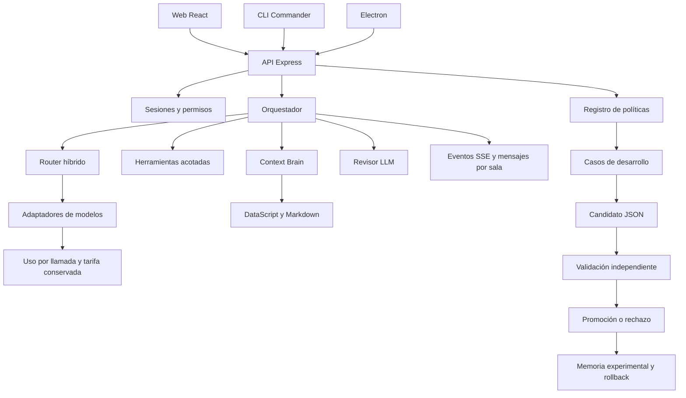

# Arquitectura de AERIS

## Decisiones

El primer mensaje del usuario define producto, estilo y restricciones. El documento adicional de arquitectura es una referencia secundaria. Se conservó Node y TypeScript para compartir contratos, runtime y empaquetado entre web, CLI y Electron, sin introducir un segundo backend Python.

## Módulos

| Módulo                 | Responsabilidad                                            |
| ---------------------- | ---------------------------------------------------------- |
| `shared/types.ts`      | Contratos de misión, uso, proveedor, skill y evento        |
| `shared/catalog.ts`    | Proveedores, modelos y tarifas con fuente                  |
| `server/index.ts`      | Transporte HTTP, esquemas de entrada y rutas               |
| `server/auth.ts`       | Scrypt, sesiones con tokens hash, OAuth y administrador    |
| `server/engine.ts`     | Construcción, herramientas, revisión, aceptación y límites |
| `server/providers.ts`  | Formatos OpenAI-compatible y Anthropic Messages            |
| `server/accounting.ts` | Normalización de uso y aritmética monetaria                |
| `server/tools.ts`      | Archivos, búsqueda, Git y herramientas disponibles         |
| `server/brain.ts`      | Páginas, backlinks y recuperación selectiva                |
| `server/inventory.ts`  | Inventario sintético y cálculo de pagos                    |
| `server/evolution.ts`  | Versiones inmutables, candidatos, gate y rollback          |
| `server/store.ts`      | Persistencia local, cifrado y bus de eventos               |

## Context Brain

Cada página pertenece a un propietario y se guarda en el estado persistido y como Markdown. Los enlaces se indexan como datoms en DataScript, la misma biblioteca de base de datos utilizada por Logseq. Las consultas Datalog resuelven backlinks; la recuperación léxica pondera título, etiquetas, bloques y relaciones explícitas.

El presupuesto de contexto se calcula antes de ensamblar el prompt. Se registran IDs de páginas y tokens estimados para auditar qué contexto fue utilizado. El importe facturado sigue dependiendo del uso medido por el proveedor. No se guarda una memoria indiscriminada de toda la computadora.

## Ciclos de mejora

El ciclo de respuestas LLM propone, revisa y conserva el mejor candidato. El revisor evalúa con una rúbrica explícita y devuelve JSON validado. Este mecanismo es refinamiento iterativo y sus puntuaciones se identifican como evaluaciones del modelo.

El ciclo de políticas opera sobre un espacio de configuración estricto. El optimizador determinista analiza fallos de desarrollo, propone un `WorkflowPolicy`, guarda su hash y evalúa con una partición diferente. La versión estable no cambia durante la evaluación. El gate exige mejora de exactitud y cero errores críticos. Una propuesta sin mejora se rechaza. El historial permite restaurar versiones aceptadas.

El benchmark incluye 50 tareas sintéticas: 20 dev, 15 validation, 15 test. La optimización nunca llama a la función de test. El test final solo se ejecuta por petición explícita a la API o CLI. Esta separación evita usar sus resultados para proponer el candidato.

## Contabilidad

Cada respuesta conserva modelo solicitado, modelo efectivo reportado, uso, proveedor, tarifa, latencia y coste. La suma del ledger coincide con el coste de la misión e incluye clasificación, herramientas LLM y revisión. Las tarifas históricas no se sustituyen al editar el catálogo.

Se calcula primero en picodólares enteros y se redondea a nanodólares por llamada. La salida incluye los tokens de razonamiento cuando el proveedor los incorpora; no se suman de nuevo. La creación y lectura de caché se facturan por separado cuando se reportan. Si falta uso completo, no se inventa una cifra y se detiene la misión.

La reserva previa usa una estimación conservadora de entrada y el máximo de salida. Es un control de gasto local para las modalidades de texto e imágenes admitidas, no un límite transaccional impuesto en la cuenta del proveedor. Una cancelación de red puede dejar consumo pendiente de reporte y se marca como incompleto.

## Persistencia y concurrencia

Una sola instancia del servidor es la escritora del espacio. Las mutaciones se serializan en el proceso, se escriben a un temporal y se renombran, con copia previa. El bus mantiene cuatro misiones concurrentes y mensajes durables entre clientes. SSE distribuye eventos y la UI reconcilia el estado periódicamente para recuperarse de reinicios y proxies que agrupen los eventos.

La persistencia JSON es apropiada para esta versión local. No equivale a una base transaccional multiworker. La migración prevista es SQLite con tablas de usuarios, runs, llamadas, notas, versiones y experimentos, conservando los contratos HTTP. Para despliegue distribuido posterior se requieren colas y límites por organización.

## Confianza

Documentos, archivos y notas son datos de tarea. No pueden ampliar permisos. Las herramientas comprueban rutas canónicas y rechazan secretos y enlaces simbólicos. La ejecución de shell arbitraria no está disponible al modelo. Las acciones de administración requieren el propietario local o la primera cuenta registrada que no sea demo.

El inventario y los pagos son sintéticos. No hay conexión ni afiliación implícita con sistemas internos de una empresa. No se modifican pesos de modelos y no se ha demostrado metaoptimización del optimizador.
